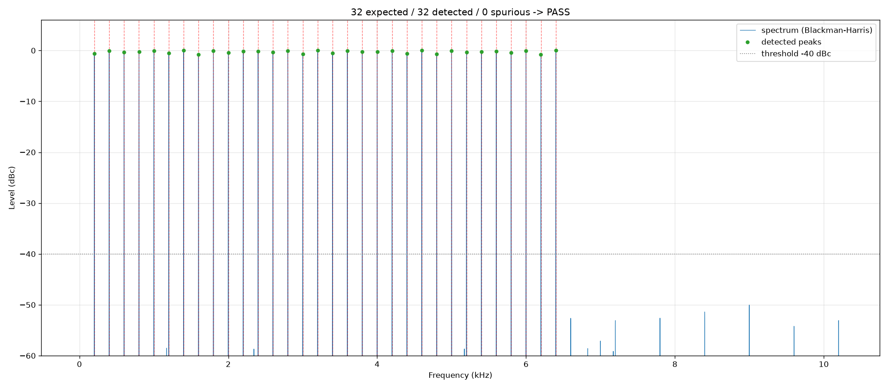

# 32 谱峰取证（2026-10-02T23:15:59）

- 结论：**PASS**
- dump：`C:\Users\Danny\Desktop\FPGA competition\.dsh\skills\fpga-verify\tests\tone_samples.txt`（65536 样本，格式 samples）
- 文件指纹：sha256:ff3a8389c9973927（385630 字节，mtime 2026-10-02T23:15:58，稳定）
- 采样率：**48828.125 Hz**（来源：derive_fs.py 从 RTL+SDC 推导）
- checker：`C:\Users\Danny\Desktop\FPGA competition\fpga_hank\tools\verify\check_peaks.py`
- 复现命令：`python C:\Users\Danny\Desktop\FPGA competition\fpga_hank\tools\verify\check_peaks.py --file C:\Users\Danny\Desktop\FPGA competition\.dsh\skills\fpga-verify\tests\tone_samples.txt --format samples --fs 48828.125 --count 32 --start 200 --step 200`

| 判据 | 门限 | 实测 | 结论 |
|---|---|---|---|
| C1 期望谱峰全部命中 | 32/32 | 32/32 | PASS |
| C2 每路可闻 | >= -40 dBc | 最低 -0.82 dBc | PASS |
| C3 无未预期谱峰 | 0 | 0 | PASS |
| C4 电平离散度 | <= 6 dB | 0.82 dB | PASS |

