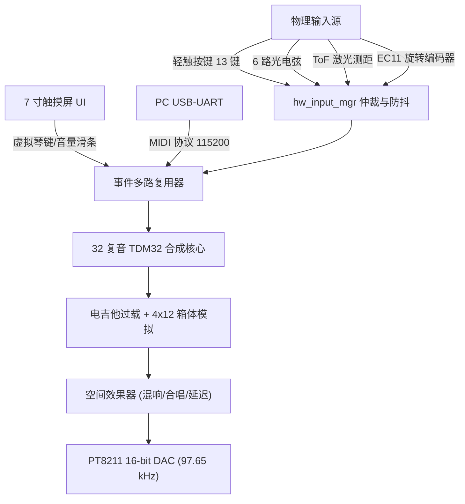

# Tang Mega 138K 多模态电子乐器与大屏交互系统使用手册

> **工程名称**：`lcd_test_j14.gprj`  
> **目标器件**：高云半导体 Arora V 系列 `GW5AST-LV138PG484AC1/I0`（GW5AST-138C，Device Version C）  
> **核心架构**：32 复音 × 6 泛音 TDM 并行物理建模声音引擎 + 7 英寸 800×480 电容触摸仪器大屏 + J13 硬件乐器外设阵列  
> **发布日期**：2026 年 11 月  

---

## 1. 系统概述与技术规格

### 1.1 总体功能定位
本系统是一款基于高云 **Tang Mega 138K** 高性能 FPGA 开发板的高保真、多模态智能电子乐器系统。系统集成了：
1. **多通道硬件演奏外设**：
   - **钢琴键盘**：13 键四脚轻触开关，覆盖 C4 至 C5 完整半音阶；
   - **光学吉他**：6 路红外对射式光电传感器，模拟吉他 6 根琴弦的标准空弦调音（E2、A2、D3、G3、B3、E4）；
   - **空间特雷门琴**：VB22B 激光 ToF 测距传感器，通过空间手势距离（10–70 cm）无接触控制音高变化；
   - **旋钮与音量控制**：EC11 旋转正交编码器，提供高精度触感音量步进调节。
2. **7 英寸 800×480 电容触摸大屏（ATK-MD0700）**：
   - 16 位 8080 并行总线驱动，纯硬件 RTL 像素流实时渲染；
   - 3.0 秒双缓冲无缝滚动音频示波器；
   - 32 频段硬件实时频谱瀑布柱状图与李萨如图形；
   - 实时乐谱自动滚屏与打谱机功能；
   - 触控虚拟钢琴键盘、触控音量推子、音色与音效切换面板。
3. **高保真声音合成与效果器链**：
   - 32 个发音通道，每通道 6 个独立谐波振荡器，共 **192 个硬件正弦振荡器**并发计算；
   - 全硬件流水线 ADSR 真实包络发声机理；
   - 电吉他高拟真非线性过载（Overdrive）+ 4×12 经典密闭音箱箱体卷积模拟（Cabinet Simulation）；
   - 混响（Reverb）、合唱（Chorus）、延迟（Delay）等硬件空间效果器；
   - 采样率高达 97,656.25 Hz，经由板载 PT8211 16-bit 环绕立体声 DAC 输出至 3.5mm 耳机及板载双声道立体声功放。

---

## 2. 硬件连接与引脚定义

系统外设主要通过 **J13 扩展排针**（硬件乐器外设）、**J14 扩展接口**（7 寸大屏）、板载按键及调试串口进行物理连接。

### 2.1 J13 硬件乐器外设接线表 (Pinout)

所有轻触开关琴键与光电传感器均以 **GND** 为参考地。FPGA 芯片内部已使能弱上拉（`PULL_MODE=UP`）。

| J13 引脚 | FPGA 球号 | 信号名称 | 对应外设与音乐语义 | 电气特性与连接说明 |
|:---:|:---:|:---:|:---|:---|
| **Pin 1** | `E14` | `key_hw[0]` | `key1` 琴键 1：**C4**（MIDI 60） | 轻触开关引脚，按下接 GND，松开悬空 |
| **Pin 2** | `E13` | `key_hw[1]` | `key2` 琴键 2：**C#4**（MIDI 61） | 轻触开关引脚，按下接 GND |
| **Pin 3** | `C15` | `key_hw[2]` | `key3` 琴键 3：**D4**（MIDI 62） | 轻触开关引脚，按下接 GND |
| **Pin 4** | `C14` | `key_hw[3]` | `key4` 琴键 4：**D#4**（MIDI 63） | 轻触开关引脚，按下接 GND |
| **Pin 5** | `B13` | `key_hw[4]` | `key5` 琴键 5：**E4**（MIDI 64） | 轻触开关引脚，按下接 GND |
| **Pin 6** | `C13` | `key_hw[5]` | `key6` 琴键 6：**F4**（MIDI 65） | 轻触开关引脚，按下接 GND |
| **Pin 7** | `A14` | `key_hw[6]` | `key7` 琴键 7：**F#4**（MIDI 66） | 轻触开关引脚，按下接 GND |
| **Pin 8** | `A13` | `key_hw[7]` | `key8` 琴键 8：**G4**（MIDI 67） | 轻触开关引脚，按下接 GND |
| **Pin 9** | `B16` | `key_hw[8]` | `key9` 琴键 9：**G#4**（MIDI 68） | 轻触开关引脚，按下接 GND |
| **Pin 10** | `B15` | `key_hw[9]` | `key10` 琴键 10：**A4**（MIDI 69） | 轻触开关引脚，按下接 GND |
| **Pin 11** | — | **悬空 (NC)** | 底板 5V_Peripheral | **扩展板上悬空不接** |
| **Pin 12** | — | **GND** | **逻辑地** | **所有传感器和按键必须共地** |
| **Pin 13** | `A16` | `key_hw[10]` | `key11` 琴键 11：**A#4**（MIDI 70） | 轻触开关引脚，按下接 GND |
| **Pin 14** | `A15` | `key_hw[11]` | `key12` 琴键 12：**B4**（MIDI 71） | 轻触开关引脚，按下接 GND |
| **Pin 15** | `A20` | `key_hw[12]` | `key13` 琴键 13：**C5**（MIDI 72） | 轻触开关引脚，按下接 GND |
| **Pin 16** | `B20` | `photo_hw[0]` | `PH1` 光电弦 1：**E2**（MIDI 40, 82.41 Hz） | 对射光电受光管，挡光接地（0），透光为 1 |
| **Pin 17** | `A21` | `photo_hw[1]` | `PH2` 光电弦 2：**A2**（MIDI 45, 110.00 Hz）| 对射光电受光管，挡光接地 |
| **Pin 18** | `B21` | `photo_hw[2]` | `PH3` 光电弦 3：**D3**（MIDI 50, 146.83 Hz）| 对射光电受光管，挡光接地 |
| **Pin 19** | `B18` | `photo_hw[3]` | `PH4` 光电弦 4：**G3**（MIDI 55, 196.00 Hz）| 对射光电受光管，挡光接地 |
| **Pin 20** | `B17` | `photo_hw[4]` | `PH5` 光电弦 5：**B3**（MIDI 59, 246.94 Hz）| 对射光电受光管，挡光接地 |
| **Pin 21** | `C17` | `photo_hw[5]` | `PH6` 光电弦 6：**E4**（MIDI 64, 329.63 Hz）| 对射光电受光管，挡光接地 |
| **Pin 22** | `D17` | `ec1a` | `EC1A` 编码器 #1 Phase A | 正交编码通道 A，旋转脉冲计数 |
| **Pin 23** | `A19` | `ec1b` | `EC1B` 编码器 #1 Phase B | 正交编码通道 B，旋转脉冲计数 |
| **Pin 24** | `A18` | `scl_tof` | `SCL1` ToF #1 I2C **SCL** | 扩展板含 4.7 kΩ 上拉到 3.3V + 330Ω 串阻 |
| **Pin 25** | `D15` | `sda_tof` | `SDA1` ToF #1 I2C **SDA** | 扩展板含 4.7 kΩ 上拉到 3.3V + 330Ω 串阻 |
| **Pin 26** | `D14` | `ec2a` | `EC2A` 编码器 #2 Phase A | 正交编码通道 A，旋转脉冲计数 |
| **Pin 27** | `D16` | `ec2b` | `EC2B` 编码器 #2 Phase B | 正交编码通道 B，旋转脉冲计数 |
| **Pin 28** | `E16` | **悬空 (NC)** | `key_pitch`（内部上拉悬空） | 扩展板上悬空不接 |
| **Pin 29** | `F14` | `scl_tof_b` | `SCL2` ToF #2 I2C **SCL** | 扩展板含 4.7 kΩ 上拉到 3.3V + 330Ω 串阻（经 R68 0Ω） |
| **Pin 30** | `F13` | `sda_tof_b` | `SDA2` ToF #2 I2C **SDA** | 扩展板含 4.7 kΩ 上拉到 3.3V + 330Ω 串阻（经 R70 0Ω） |
| **Pin 31** | `E17` | `aux_io[0]` | `AUX1`（预留给触屏） | 3.3V LVCMOS 输入（内部上拉） |
| **Pin 32** | `F16` | `aux_io[1]` | `AUX2`（预留给触屏） | 3.3V LVCMOS 输入（内部上拉） |
| **Pin 33** | `F19` | `aux_io[2]` | `AUX3`（预留给触屏） | 3.3V LVCMOS 输入（内部上拉） |
| **Pin 34** | `F15` | `aux_io[3]` | `AUX4`（预留给触屏） | 3.3V LVCMOS 输入（内部上拉） |
| **Pin 35** | `C20` | `aux_io[4]` | `AUX5`（预留给触屏） | 3.3V LVCMOS 输入（内部上拉） |
| **Pin 36** | `D20` | `aux_io[5]` | `AUX6`（预留给触屏） | 3.3V LVCMOS 输入（内部上拉） |
| **Pin 37** | `D19` | `ec3a` | `EC3A` 编码器 #3 Phase A | 正交编码通道 A，旋转脉冲计数 |
| **Pin 38** | `E19` | `ec3b` | `EC3B` 编码器 #3 Phase B | 正交编码通道 B，旋转脉冲计数 |
| **Pin 39** | `C19` | `ec4a` | `EC4A` 编码器 #4 Phase A | 正交编码通道 A，旋转脉冲计数 |
| **Pin 40** | `C18` | `ec4b` | `EC4B` 编码器 #4 Phase B | 正交编码通道 B，旋转脉冲计数 |

> [!IMPORTANT]
> **ToF 传感器双总线支持说明**：
> 1. 固件同时在 **SCL1/SDA1**（**J13-24 `A18` / J13-25 `D15`**，对应扩展板 `H9`）与 **SCL2/SDA2**（**J13-29 `F14` / J13-30 `F13`**，对应扩展板 `H8`）两套独立 I2C 总线上以 50 Hz 并发轮询 VB22B ToF 传感器（7 位地址 `0x52`）；
> 2. 无论您将 ToF 模块插在第一路（Pin 24/25）还是第二路（Pin 29/30），系统均能自动识别并驱动特雷门琴发声；
> 3. 4 路旋转编码器（`EC1`~`EC4`，对应 Pin 22/23、26/27、37/38、39/40）全部启用正交解码，任意旋转均可实时调节系统音量。

---

### 2.2 7 英寸 J14 大屏与音频接口

1. **J14 8080 并行显示总线**：
   - 屏幕直插 Tang Mega 138K 专用 40-pin J14 LCD 接口（ATK-MD0700 模组，SSD1963 驱动）；
   - 电容触摸总线复用 J14 上的 I2C（`AA18`/`AA19`）及中断引脚（`Y19`）。
2. **音频输出接口**：
   - **板载 3.5mm 耳机接口**：由 PT8211 驱动（`Y17`=BCK, `AB17`=WS, `AA16`=DIN），可直推耳机或外接有源音箱；
   - **板载 2×3W 扬声器功放**：功放使能脚 `PA_EN`（`AB16`）在 RTL 中恒驱动为 `0`（常开使能），可直接驱动接线端子扬声器。
3. **USB-UART 串口**：
   - **UART RX**：引脚 `V14`（板载 FT2232H 虚拟串口 Channel B，通常为 PC 端的 COM 口），波特率 **115200 8N1**；
   - **UART TX / 截屏输出**：引脚 `U15`。

---

## 3. 固件构建与烧录步骤

### 3.1 环境要求
- 操作系统：Windows 10 / 11
- 综合软件：Gowin EDA（`Gowin_V1.9.12.04_x64` 或兼容版本）
- 解释器：Python 3.8+（已配置 Gowin 环境变量或工具链）
- 编程烧录器：openFPGALoader 或 Gowin Programmer（连接板载 JTAG USB 接口）

### 3.2 一键编译构建 (Build)
在项目根目录 `C:\Users\gjl50\Desktop\FPGA\fpga_spark\lcd_test\` 打开 PowerShell 或终端，运行：
```powershell
python build_j14.py
```
*构建流程说明*：
1. 脚本将自动检索系统中的 `gw_sh.exe` 并执行 `tools/gowin/build.tcl`；
2. 执行 SystemVerilog 2017 综合，处理 32 声部 TDM 运算核心、效果器与 800×480 UI 状态机；
3. 加载物理约束 [lcd_test_j14.cst](file:///C:/Users/gjl50/Desktop/FPGA/fpga_spark/lcd_test/constraints/lcd_test_j14.cst) 与时序约束 [lcd_test_j14.sdc](file:///C:/Users/gjl50/Desktop/FPGA/fpga_spark/lcd_test/constraints/lcd_test_j14.sdc)；
4. 编译成功后在 `bitstream/` 目录下生成 `lcd_test_j14.fs` 位流文件。

### 3.3 一键在线烧录 (Flash to SRAM)
确保 Tang Mega 138K 开发板通过 USB 数据线连接到电脑，运行：
```powershell
python burn_lcd_j14.py
```
烧录过程耗时约 25~30 秒。终端输出 `[PASS] 烧录成功，设备已就绪` 且板载 LED 开始心跳闪烁即代表固件运行成功。

---

## 4. 四大工作模式与演奏指南

固件支持在 [top.v](file:///C:/Users/gjl50/Desktop/FPGA/fpga_spark/lcd_test/rtl/top.v#L41) 中通过顶层参数 `MODE` 进行配置，默认配置为 **MODE=3（全模态硬件乐器演奏模式）**。



### 4.1 MODE 3：全模态硬件乐器演奏模式（默认运行模式）
此模式下，**J13 物理乐器、7寸电容触摸大屏与 PC 串口 MIDI 全面融合并发响应**，无冲突抢占：

#### 1. 13 键钢琴按键演奏
- **琴键映射**：J13-1 至 J13-15 对应标准 C4 至 C5 完整八度（13 音阶，含半音黑键）；
- **发声特性**：力度固定为标准 vel 100，按下时触发 Note-On，松开时触发 Note-Off；
- **声部与复音**：支持 13 键任意多键齐奏与和弦，系统内部由 TDM32 调度 32 个复音发声，无破音和丢音。

#### 2. 6 弦光学吉他演奏
- **琴弦映射**：J13-16 至 J13-21 对应吉他 6 根标准调音空弦：
  - 弦 1 (`photo_hw[0]`)：**E2** (40 号音, 82.41 Hz)
  - 弦 2 (`photo_hw[1]`)：**A2** (45 号音, 110.00 Hz)
  - 弦 3 (`photo_hw[2]`)：**D3** (50 号音, 146.83 Hz)
  - 弦 4 (`photo_hw[3]`)：**G3** (55 号音, 196.00 Hz)
  - 弦 5 (`photo_hw[4]`)：**B3** (59 号音, 246.94 Hz)
  - 弦 6 (`photo_hw[5]`)：**E4** (64 号音, 329.63 Hz)
- **演奏手法**：用拨片或手指划过光电探头遮挡光束，遮挡瞬间触发重音拨弦（力度 vel 110），移开手指结束遮挡时包络自然进入衰减释放。

#### 3. 空间无接触特雷门琴演奏
- **测距控制音高**：
  - 手掌置于 ToF 传感器上方 **10 cm 至 70 cm** 范围内；
  - 系统以每 24 mm 为一音级阶梯，对应 MIDI 音符 60 至 84（C4 至 C6，共 25 个半音阶）；
  - 手掌越靠近传感器音高越低，手掌逐渐抬高音调随之爬升；
- **防抖与迟滞**：内置 5 点中值滤波与 ±20 mm 迟滞门限。手移出大于 80 cm 范围持续 200 ms 自动发送 Note-Off 停音。

#### 4. 旋钮与音量控制
- 顺时针旋转 EC11 编码器增大总音量，逆时针旋转减小总音量；
- 旋钮步进变化将**实时双向同步至 7 寸屏幕上的虚拟音量推子**。

---

### 4.2 MODE 0：曲目自动演示模式
板载内置纯算法实时合成曲库，不使用任何录音音频片段：
1. **播放/暂停**：按下板载用户按键 **Key0 (`AB13`)**，启动或暂停播放；
2. **循环切歌**：在播放状态下按下板载按键 **Key1 (`Y12`)** 或 **Key2 (`AA19`)** 切歌；
3. **曲目列表**：
   - `[0]` 我落泪情绪零碎 (副歌段)
   - `[1]` Ode to Joy (贝多芬《欢乐颂》)
   - `[2]` Twinkle Twinkle (小星星)
   - `[3]` Jingle Bells (铃儿响叮当)
   - `[4]` Für Elise (致爱丽丝)
4. **大屏联动**：播放过程中，屏幕实时显示打谱滚屏五线谱，音符随节拍在五线谱上跳动，并高亮发声琴键。

---

### 4.3 MODE 1：电脑上位机控制模式
电脑通过 Type-C 数据线连接开发板虚拟串口（115200 8N1），运行上位机软件：
- 电脑软键盘弹奏：直接运行 `python host/piano_gui.py` 开启可视化演奏界面；
- 标准 MIDI 文件推流播放：运行 `python host/midi_player.py your_song.mid`；
- 此时板载按键 Key1 可循环切换四档效果器（旁路 → 延迟 → 合唱 → 混响）。

---

### 4.4 MODE 2：32 独立谱峰测试与合规取证模式
- 专为技术评审与频谱取证设计的测试模式；
- 32 个发音通道恒定产生等间距不重叠纯正弦波振荡，连接音频频谱仪可在频域上清晰计数 32 根独立离散谱峰，充分验证 32 复音硬件算力。

---

## 5. 7 英寸仪器大屏 UI 界面与触控说明

```text
+-------------------------------------------------------------------------------+
| [FPGA MULTI-SYNTH]   VOL: 100/127   VOICES: 04/32   TIMBRE: PIANO   FX: BYPASS|
+------------------------------------+------------------------------------------+
|                                    |               [触控钢琴键盘]              |
|        3.0s 双缓冲实时滚动示波器      |                                          |
|        (真实音频采样波形无撕裂显示)    |  | | | | | | | | | | | | | | | | | | |   |
|                                    |  |_|_|_|_|_|_|_|_|_|_|_|_|_|_|_|_|_|_|   |
+------------------------------------+------------------------------------------+
|  32段硬件音频频谱瀑布图 / 李萨如图形  | [音色选择] 钢琴 / 吉他 / 小提琴 / 二胡     |
|  [■■■■■■■■■■■■■■■■■■■■■■■■■■■■■■■■]| [效果器]   旁路 / 延迟 / 合唱 / 混响     |
|  0Hz ------------ 24kHz ------------| [主音量滑条] ======[●]================== |
+------------------------------------+------------------------------------------+
```

1. **实时示波器区域（左上方）**：
   - 展现经过硬件混音与效果处理后的真实输出波形；具备智能空闲检测，在无音频输出时自动平滑回中，无直流偏移与底噪杂波。
2. **硬件频谱仪（左下方）**：
   - 32 根频段柱状图，实时反应低频（贝斯/鼓点）、中频（钢琴基音）、高频（泛音与空气感）能量分布。
3. **触控键盘区（右上方）**：
   - 可以在屏幕上直接用手指点击白键与黑键进行触摸演奏；
   - 当硬件物理琴键（J13-1~15）按下时，屏幕对应的琴键会**同步变为高亮绿色**，实时反馈硬件输入状态。
4. **功能控制面板（右下方）**：
   - **音色选择按钮**：轻触可依次切换 **钢琴 (Piano)** → **电吉他 (Guitar)** → **小提琴 (Violin)** → **二胡 (Erhu)**；
   - **效果器按钮**：轻触可切换 **旁路 (Bypass)** → **延迟 (Delay)** → **合唱 (Chorus)** → **混响 (Reverb)**；
   - **触控音量推子**：手指滑动滑块可直接调节系统总音量。

---

## 6. 常见问题与故障排查 (Troubleshooting FAQ)

### Q1: 钢琴和吉他都能正常发声，为什么特雷门琴没有声音反应？
1. **检查自研 PCB 的 3.3V 电源引入（最常见原因）**：
   - Tang Mega 138K 的 J13 排针全为 FPGA IO，**不提供 3.3V 电源**（Pin 11 为 5V，Pin 12 为 GND）。
   - PCB 上的 ToF 接口（`H9`/`H8`）与 4.7 kΩ 上拉电阻由 PCB 上的端子 **`H3`** 取电。必须从 Tang Mega 底板 J8 接口的 3.3V 引出一根杜邦线插到 PCB 的 `H3` 端子。若未插这根线，轻触琴键因为依靠 FPGA 内部弱上拉仍可发声，但 ToF 会因彻底断电而报 NACK。
2. **检查 4.7 kΩ 上拉与 330 Ω 串阻焊接**：
   - I2C 总线为开漏结构，必须保证 SCL/SDA 的 4.7 kΩ 上拉与 330 Ω 限流电阻阻值焊接准确无误。实测若发生阻值错焊会导致 I2C 电平上升沿失常，从机无法响应 ACK。（详见 [`../../docs/HARDWARE-BRINGUP-LOG-20261103.md`](file:///C:/Users/gjl50/Desktop/FPGA/fpga_spark/docs/HARDWARE-BRINGUP-LOG-20261103.md)）。
3. **检查接线排针与 4P 线序**：
   - 固件支持双路 ToF 接口：第一路 **SCL1=J13-24 (`A18`) / SDA1=J13-25 (`D15`)**（扩展板 `H9`），第二路 **SCL2=J13-29 (`F14`) / SDA2=J13-30 (`F13`)**（扩展板 `H8`）。
   - 接口线序为：`Pin 1=SCL, Pin 2=SDA, Pin 3=+3.3V, Pin 4=GND`。请核对模块引脚是否对应，防止线束反插。
4. **使用专属调试工程快速秒测**：
   - 可直接烧录轻量调试工程 [`../../tof_debug/`](file:///C:/Users/gjl50/Desktop/FPGA/fpga_spark/tof_debug/)，该工程 20 秒即可编译下载，通过 7 寸屏幕直显与串口动态条状图，可实时查看双总线 112 个 I2C 地址的 ACK 响应状态与毫米级距离。
5. **手势与音色特性**：
   - 测距有效范围在 10 cm 至 70 cm 之间，初次进入需保持稳定约 60 ms；
   - 默认钢琴音色在手掌停留时会自然衰减，需前后推拉手掌移动跨过 24 mm 刻度才能连续激发换音。

### Q2: 声音输出有破音、杂音或者完全没有声音？
1. **检查音量设置**：
   - 查看 7 寸屏右上角 `VOL` 数值，若为 0 可通过顺时针旋转 EC11 旋钮或在触摸屏上向右拖动音量推子增大音量；
2. **检查音频跳线与功放开关**：
   - 确认耳机插头已插到底；
   - RTL 中 `PA_EN` 默认开启，若需彻底静音扬声器仅保留耳机输出，可在顶层配置。

### Q3: 触摸屏点击无反应？
1. **排线接触检查**：检查 J14 40-pin 软排线是否插正、压扣是否卡紧；
2. **复位与中断引脚**：电容触摸驱动使用 FT5206 控制器，复位引脚 `W17` 需为高电平；系统上电后触摸芯片会自动校准基线。

---

## 7. 技术维护与文件清单

- **顶层工程文件**：[lcd_test_j14.gprj](file:///C:/Users/gjl50/Desktop/FPGA/fpga_spark/lcd_test/lcd_test_j14.gprj)
- **顶层 RTL 模块**：[top.v](file:///C:/Users/gjl50/Desktop/FPGA/fpga_spark/lcd_test/rtl/top.v)
- **硬件乐器管理器**：[hw_input_mgr.v](file:///C:/Users/gjl50/Desktop/FPGA/fpga_spark/lcd_test/rtl/io/hw_input_mgr.v)
- **32 复音 TDM 引擎**：[piano_engine_tdm32.v](file:///C:/Users/gjl50/Desktop/FPGA/fpga_spark/lcd_test/rtl/synth/piano_engine_tdm32.v)
- **7 寸屏仪器 UI 核心**：[lcd_ui.v](file:///C:/Users/gjl50/Desktop/FPGA/fpga_spark/lcd_test/rtl/ui/lcd_ui.v)
- **引脚物理约束**：[lcd_test_j14.cst](file:///C:/Users/gjl50/Desktop/FPGA/fpga_spark/lcd_test/constraints/lcd_test_j14.cst)
- **时序约束文件**：[lcd_test_j14.sdc](file:///C:/Users/gjl50/Desktop/FPGA/fpga_spark/lcd_test/constraints/lcd_test_j14.sdc)
- **构建脚本**：[build_j14.py](file:///C:/Users/gjl50/Desktop/FPGA/fpga_spark/lcd_test/build_j14.py)
- **烧录脚本**：[burn_lcd_j14.py](file:///C:/Users/gjl50/Desktop/FPGA/fpga_spark/lcd_test/burn_lcd_j14.py)
